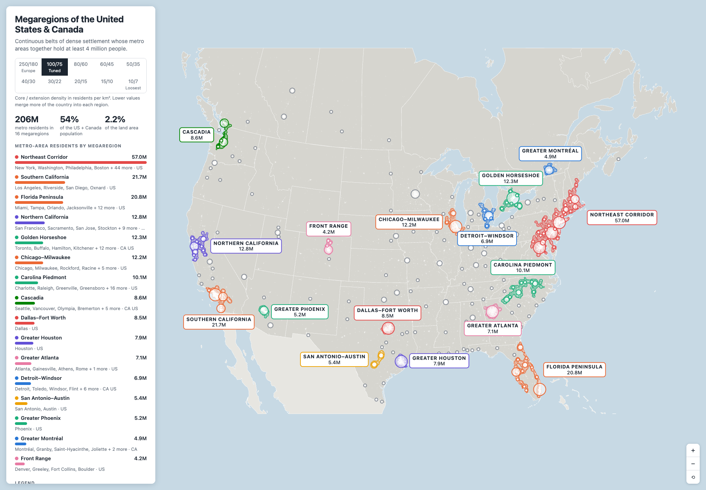
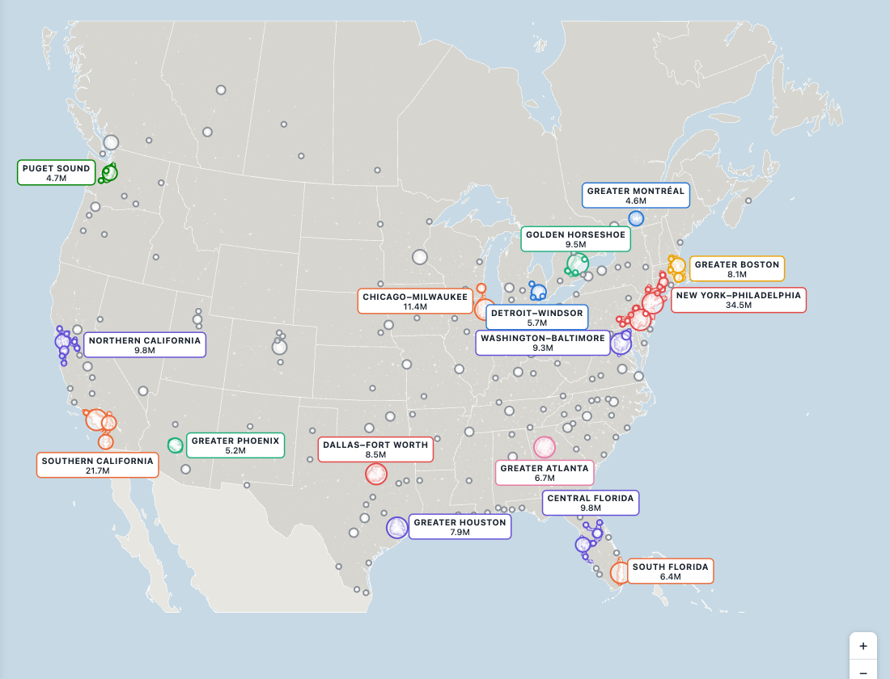
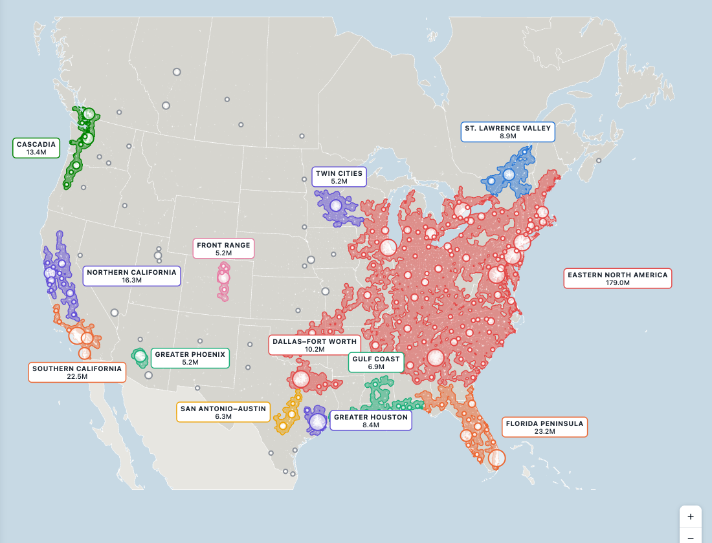

<h1 align="center">Megaregions of the United States &amp; Canada</h1>

<p align="center">
  Where North America's dense settlement runs together into belts of 4 million people or more — computed from a 1 km population grid, not drawn by hand.
</p>

<p align="center">
  <a href="https://mega-regions-na.vercel.app"></a>
  
  
  
  
</p>

<p align="center">
  <a href="#quick-start">Quick start</a> — <a href="#what-the-thresholds-show">Findings</a> — <a href="#the-method">Method</a> — <a href="#using-the-map">Using the map</a> — <a href="#how-it-is-built">Architecture</a> — <a href="#checks">Checks</a> — <a href="#data-and-licences">Provenance</a>
</p>

<p align="center">
  <a href="https://mega-regions-na.vercel.app"></a>
</p>

<p align="center">
  
  
</p>

<p align="center"><sub>Left: Europe's thresholds (250/180). Right: a loose setting (20/15), where the East becomes one region of 179 million.</sub></p>

> **Demo:** https://mega-regions-na.vercel.app

A North American replication of a Europe megaregions map by @47Tolkien, which was itself modelled on America 2050. The original printed its method, and every input has a public US and Canadian equivalent, so the same recipe can be run here. The site lets you switch between ten density thresholds and watch the regions separate, merge and finally swallow half the continent.

---

## Quick start

Just look at it:

```bash
python3 -m http.server 8765 --directory site   # http://localhost:8765
```

The built data is committed, so that is all the site needs. To rebuild it from the public sources:

```bash
uv run python pipeline/fetch.py    # download raw inputs into data/raw (about 400 MB, needs curl)
uv run python pipeline/build.py    # data/raw -> site/data.json + site/glow.png
```

No API keys. Python 3.13 with [uv](https://docs.astral.sh/uv/); the site itself is one HTML file with D3 from a CDN.

---

## What the thresholds show

Each option is a pair: the smoothed density that defines a **core**, and the lower density a region **extends** out to.

| Core / extension (residents per km²) | Megaregions | Metro residents | Share of US + Canada | Share of area | Largest region |
|---|---|---|---|---|---|
| 250 / 180 (Europe's) | 16 | 163.8M | 43% | 1.0% | New York–Philadelphia, 34.5M |
| **100 / 75 (default)** | 16 | 205.7M | 54% | 2.2% | Northeast Corridor, 57.0M |
| 80 / 60 | 17 | 217.8M | 57% | 2.8% | Northeast Corridor, 57.1M |
| 60 / 45 | 18 | 242.6M | 63% | 3.9% | Northeast Corridor, 58.8M |
| 50 / 35 | 18 | 258.6M | 67% | 5.1% | Northeast Corridor, 62.3M |
| 40 / 30 | 15 | 269.5M | 70% | 6.1% | Northeast Corridor, 63.1M |
| 30 / 22 | 15 | 290.7M | 76% | 8.3% | Northeast–Great Lakes, 113.0M |
| 20 / 15 | 13 | 310.6M | 81% | 11.9% | Eastern North America, 179.0M |
| 15 / 10 | 8 | 319.8M | 83% | 15.1% | Eastern North America, 201.1M |
| 10 / 7 | 5 | 324.8M | 85% | 17.7% | Eastern & Central North America, 260.2M |

What that table is saying:

- **Europe's thresholds do not fragment North America, but they do split the Northeast.** At 250/180, Boston, New York–Philadelphia and Washington–Baltimore are three regions. Raising or lowering the core between 150 and 300 barely changes anything, because North American cores are dense but far apart.
- **The Boston–Washington corridor only appears around 100/75.** That is where the three merge into one 57M region, Florida becomes a single peninsula region, and Cascadia reaches Vancouver. This is the setting closest to the familiar America 2050 picture, so it is the default.
- **40/30 is the last setting that still describes megaregions.** It reproduces America 2050's Great Lakes (47.8M, with the Ohio Valley) and Piedmont Atlantic (29.9M) regions, though the Great Lakes region has 145 member metros.
- **Below 40/30 the method draws "where people live".** At 30/22 the Northeast and the Great Lakes fuse into 113M people; by 20/15, 81% of the two countries' population sits in megaregions on 12% of the area.
- **Some regions barely move.** Southern California is 21.7M at 250/180 and 22.5M at 20/15. Greater Phoenix is 5.2M at every setting down to 15/10. Mountains and desert do what thresholds cannot.

---

## The method

1. Take the **GHSL 1 km population grid**, reproject it to North America Albers Equal Area so every cell is one square kilometre, and zero out cells outside the US and Canada.
2. **Smooth** it with a 10 km Gaussian. The result is residents per km².
3. **Cores** are continuous areas above the core threshold.
4. A **metro area** (a US Census CBSA, or a Statistics Canada CMA or CA) belongs to a core when at least half of its gridded residents live inside it. A core is kept when its member metros' official populations total 4 million or more.
5. Each kept core **grows** out to the extension threshold by a watershed on inverted density, so where two regions meet the border follows the lowest-density divide.
6. Metros are assigned to the grown regions by the same half-or-more rule. A region's population is the **sum of its member metros' official 2025 estimates**.

Things worth knowing before quoting a number:

- **Populations are whole metro areas, not the shaded shape.** A region's figure counts every resident of each member metro, and no one outside a metro, even if they live inside the boundary.
- **Membership is all or nothing.** A metro with 49% of its residents in a region contributes nothing to it.
- **Area is the shaded shape**, measured against all US and Canadian territory outside major lakes (19.1M km²).
- **Alaska, Hawaii and the far north are off the map**, and Mexico is out of scope, so San Diego's region stops at the border.
- **The grid runs 5–13% under official figures in Canadian metros.** Membership is unaffected, but density thresholds are slightly harsher north of the border.

---

## Using the map

| | |
|---|---|
| Threshold buttons | switch between the ten core/extension pairs |
| Hover a region | population, area and largest metros; the rest of the map dims |
| Hover a metro circle | its full name, 2025 population and megaregion |
| Hover or tab to a bar | highlights that region on the map |
| Scroll, pinch or `+` `−` `⟲` | zoom and reset |
| Drag | pan |

Circles are metro areas of 250,000 or more, in four sizes. A coloured ring means the metro is in a megaregion; grey means it is not. The white speckle is 1 km cells with 300 or more residents.

---

## How it is built

```
pipeline/fetch.py   downloads the raw inputs into data/raw
pipeline/build.py   grid -> smoothed density -> cores -> watershed -> site data
site/index.html     the whole front end: one file, D3, no build step
site/data.json      basemap, metros and all ten threshold sets (built)
site/glow.png       the settlement speckle, at 2 km (built)
docs/               README screenshots
```

**Everything is pre-projected.** The pipeline writes every coordinate in Albers kilometres, and the page draws them with a plain linear transform. The browser does no map projection, so the vector shapes and the raster speckle cannot drift apart.

**All ten threshold sets ship in one 1.1 MB file.** Switching is instant because nothing is computed in the browser.

**Colour follows the region, not its rank.** Eight hues from a validated categorical palette are assigned by a region's largest metro, chosen so that regions which ever share a border differ. A region keeps its colour as thresholds change. Labels are dark text with a coloured outline, so identity never rests on colour alone.

**The knobs are constants at the top of `pipeline/build.py`:** the threshold sets, the 4M floor, the 50% membership share, the smoothing radius, the map frame, and the naming rules.

Other commands:

```bash
uv run python pipeline/build.py --sweep   # print a threshold sweep (its own grid, not the site's ten)
vercel deploy site --prod --yes           # deploy
```

Poster image (macOS, with the local server running):

```bash
"/Applications/Google Chrome.app/Contents/MacOS/Google Chrome" --headless --hide-scrollbars --window-size=1800,1250 --virtual-time-budget=5000 --screenshot=poster.png http://localhost:8765
```

`build.py` caches the reprojected grid in `data/cache`; delete that folder if the inputs or the frame change. Simplified geometry in `data.json` can differ in the last digit across GEOS versions.

---

## Checks

The map this replicates was criticised for a regional total far above reality, most likely from metros assigned to the wrong cluster. So the numbers here were checked by reviewers that did not read the pipeline, working only from the output and the official files:

- **Every metro population matches** the Census and Statistics Canada 2025 files exactly (841 metros).
- **Every region total equals the sum of its members**, no metro is in two regions of one threshold set, and every region is at least 4M, across all ten sets.
- **Totals only grow as thresholds fall**, and a metro that is a member at one threshold is still a member at every lower one.
- **The reprojection conserves population** to within 0.004%.

`build.py` itself stops if the grid and the official figures disagree: it compares gridded and official population for every metro of 250,000 or more and requires the median ratio to be within 10% (it is 0.993).

Known soft spots: region names are hand-written rules and get loose at low thresholds; the Northeast Corridor at 100/75 runs about 770 km from Maine to southern Maryland and includes around fifteen small metros; on a phone the labels overlap at the default zoom.

---

## Data and licences

`site/data.json`, `site/glow.png`, `poster.png` and the images in `docs/` are derived from:

- **GHS-POP R2023A, epoch 2025, 1 km** © European Union, Joint Research Centre, [CC BY 4.0](https://creativecommons.org/licenses/by/4.0/). Reprojected to Albers, smoothed and thresholded here.
- **US Census Bureau** Vintage 2025 population estimates and 2023 CBSA cartographic boundaries. Public domain; not endorsed by the Census Bureau.
- **Statistics Canada**, table 17-10-0148-01 and 2021 Census cartographic boundary files (CMA/CA layer of the `Cartographic_boundary_files` map service). Adapted from Statistics Canada under the [Statistics Canada Open Licence](https://www.statcan.gc.ca/en/reference/licence). This does not constitute an endorsement by Statistics Canada of this product.
- **Natural Earth** 10m and 50m admin layers. Public domain.

The raw downloads are not committed. No licence has been chosen for the code yet.
